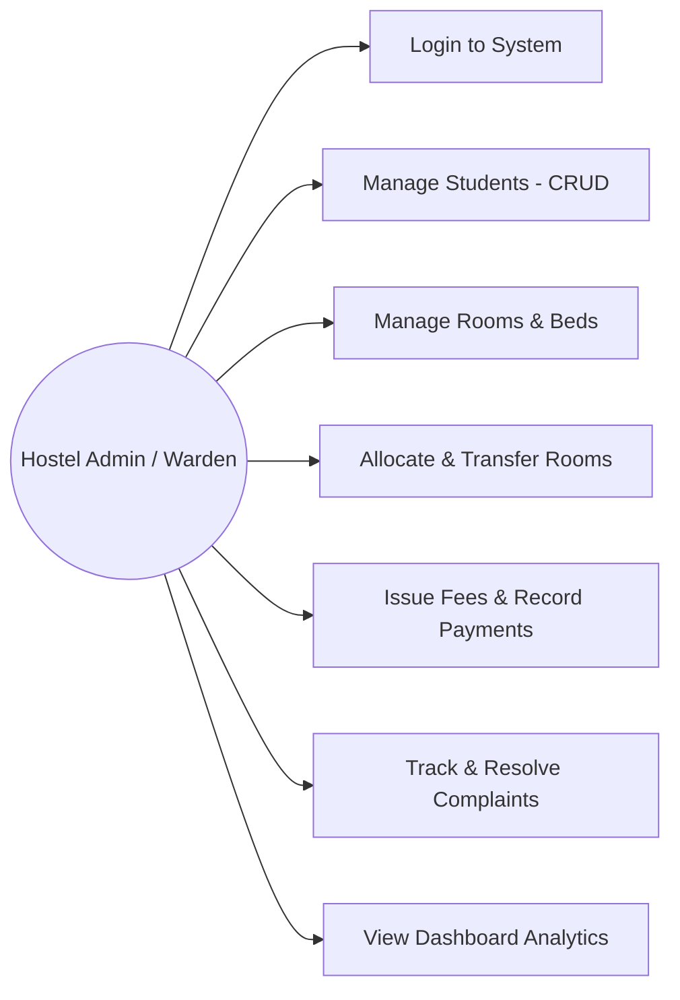
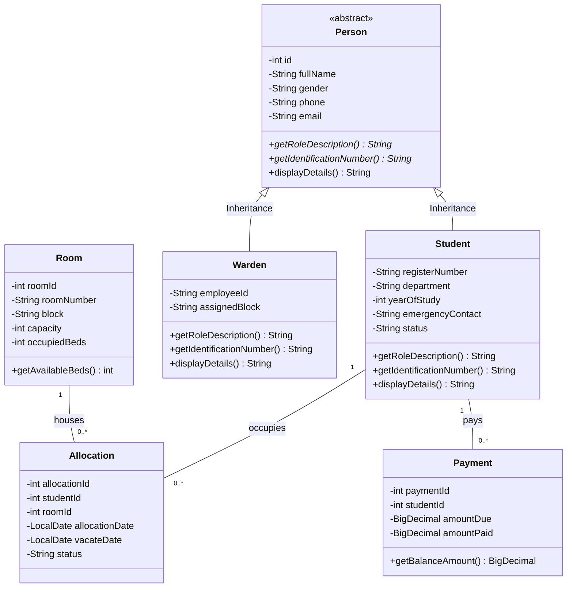

# COLLEGE PROJECT REPORT
## HOSTEL MANAGEMENT SYSTEM USING JAVA AND MYSQL

**Submitted in partial fulfillment of the requirements for the award of the degree of**  
**BACHELOR OF TECHNOLOGY (B.TECH)**  
**IN**  
**COMPUTER SCIENCE AND ENGINEERING**

---

### PRELIMINARY PAGES

#### 1. BONAFIDE CERTIFICATE
This is to certify that the project report entitled **"HOSTEL MANAGEMENT SYSTEM USING JAVA AND MYSQL"** is the bonafide work done by **[STUDENT NAME / TEAM MEMBERS]** (Register No(s): **[REGISTER NUMBER(S)]**) under my supervision and guidance in partial fulfillment of the requirements for the course **Object-Oriented Programming (OOP) and Database Management Systems (DBMS)** for the academic year 2026–2027.

**Project Guide:**  
`[NAME OF FACULTY GUIDE]`  
`[DESIGNATION / DEPARTMENT]`  
`[COLLEGE / UNIVERSITY NAME]`  

**Head of Department:**  
`[NAME OF HEAD OF DEPARTMENT]`  
`Department of Computer Science and Engineering`  
`[COLLEGE / UNIVERSITY NAME]`  

**External Examiner Signature:** ___________________________  
**Internal Examiner Signature:** ___________________________  

---

#### 2. STUDENT DECLARATION
We, the undersigned, hereby declare that the project entitled **"HOSTEL MANAGEMENT SYSTEM USING JAVA AND MYSQL"** submitted to the Department of Computer Science and Engineering is a record of original work carried out by us under the guidance of `[NAME OF FACULTY GUIDE]`. This work has not been submitted in part or full to any other University or Institution for the award of any diploma or degree.

Date: 30/10/2026  
Place: `[COLLEGE CAMPUS]`  

1. `[STUDENT 1 NAME]` (Reg. No: `[REG NO 1]`) - Signature: ______________  
2. `[STUDENT 2 NAME]` (Reg. No: `[REG NO 2]`) - Signature: ______________  

---

#### 3. ACKNOWLEDGEMENT
We express our deepest gratitude to our project guide, `[NAME OF FACULTY GUIDE]`, for invaluable advice, continuous encouragement, and constructive critique throughout the design and implementation of this software. We also thank our Head of Department and the Computer Science Faculty for providing the laboratory facilities and computing environment. Finally, we thank our parents and fellow classmates for their unwavering support.

---

#### 4. ABSTRACT
Hostel administrative operations in higher educational institutions encompass student admissions, room allocation, bed capacity monitoring, fee ledger tracking, and maintenance grievance handling. Traditional paper-based registers or fragmented spreadsheets suffer from human recording errors, delayed reconciliations, accidental over-allocation of room beds, and lack of real-time visibility.

This project presents a native desktop **Hostel Management System** developed using **Java 17 (Swing & FlatLaf)**, **JDBC**, and **MySQL 8.x**. The system follows a clean 3-tier layered architecture (Presentation, Business Logic, and Data Access) and practically implements all six core Object-Oriented Programming (OOP) concepts: **Encapsulation**, **Inheritance**, **Polymorphism**, **Abstraction**, **Packages**, and **Exception Handling**. Database integrity is enforced through InnoDB relational constraints, salted SHA-256 password hashing, parameterized SQL PreparedStatements, and atomic JDBC transactions for room transfers. Automated unit tests using JUnit 5 and Mockito validate core business rules. The resulting desktop solution provides real-time dashboard analytics, prevents room over-capacity, and eliminates duplicate student registrations.

---

### CHAPTER 1: INTRODUCTION

#### 1.1 Background
Hostel residential services are an essential component of modern collegiate campuses. With student populations growing across engineering disciplines, administrators must manage multi-block room inventories, assign roommates, collect installment fees, and address maintenance grievances promptly.

#### 1.2 Problem Statement
Manual hostel administration systems face several critical challenges:
1. **Bed Allocation Overlaps**: Allocating more students than the physical bed capacity of a room.
2. **Duplicate Records**: Registering students with identical registration numbers across different semesters.
3. **Fee Discrepancies**: Missing historical payment records and inaccurate balance tracking.
4. **Slow Grievance Resolution**: Unresolved plumbing, electrical, or network complaints without status tracking.

#### 1.3 Objectives
- Design and develop a reliable native Java desktop application.
- Implement all six core Java OOP concepts in production-grade code.
- Design a normalized relational MySQL schema with primary and foreign keys.
- Ensure 100% parameterization with JDBC PreparedStatement to prevent SQL injection.
- Implement database transactions for atomic operations such as student room transfers.
- Deliver an executive dashboard with dynamic summary metrics.

#### 1.4 Scope
The system is scoped for hostel wardens, administrative clerks, and chief supervisors. It covers student directory records, room inventory, bed occupancy calculation, allocation history, fee invoicing, and maintenance ticketing.

---

### CHAPTER 2: REQUIREMENTS AND FEASIBILITY

#### 2.1 Functional Requirements
- **FR1: Administrator Authentication**: Secure login via username and salted SHA-256 password hashes.
- **FR2: Student Management**: Add, update, search, and delete students with duplicate checks.
- **FR3: Room Management**: Add, modify, and track rooms with capacity limits.
- **FR4: Room Allocation & Transfers**: Allocate beds, transfer rooms using transactions, and vacate rooms.
- **FR5: Fee Ledger Management**: Record fee invoices, track payments, and calculate pending balances.
- **FR6: Complaint Management**: File, search, and update grievance status (Open, In Progress, Resolved).
- **FR7: Dashboard Metrics**: Display live counts of students, rooms, occupied beds, free beds, and dues.

#### 2.2 Non-Functional Requirements
- **Security**: Zero plaintext passwords; protection against SQL injection.
- **Performance**: Sub-second UI response time on standard desktop hardware.
- **Reliability**: Atomic database transactions guaranteeing zero orphaned records.
- **Usability**: Clean modern FlatLaf UI with visual status indicators and confirmation dialogs.

#### 2.3 Hardware and Software Requirements
- **Hardware**: Intel Core i3 or higher / AMD Ryzen; 4 GB RAM minimum; 500 MB free storage.
- **Software**: Windows 10/11, JDK 17 (Java Development Kit), Apache Maven 3.9+, MySQL 8.x Server & MySQL Workbench.

#### 2.4 Feasibility Study
- **Technical Feasibility**: Built with mature, standard technologies (Java 17 and MySQL 8.x).
- **Operational Feasibility**: Intuitive Swing GUI requiring zero special technical training.
- **Economic Feasibility**: Built entirely on free and open-source software (FOSS).

---

### CHAPTER 3: SYSTEM ANALYSIS AND DESIGN

#### 3.1 Existing vs. Proposed System
| Feature | Legacy Manual / Spreadsheet System | Proposed Desktop Application |
|---|---|---|
| Room Over-Allocation | Frequent human counting errors | Automatically blocked via capacity checks |
| Data Redundancy | High across loose sheets | Zero redundancy via 3NF relational design |
| Security | Plain text or unlocked files | Salted SHA-256 authentication |
| Search Speed | Manual page flipping | Instant keyword queries via SQL indexes |

#### 3.2 System Architecture
The application employs a **3-Tier Layered Architecture**:
```
┌────────────────────────────────────────────────────────┐
│           Presentation Layer (Java Swing UI)           │
│  LoginFrame | MainFrame | DashboardPanel | StudentPanel │
└───────────────────────────┬────────────────────────────┘
                            │ Method Calls
┌───────────────────────────▼────────────────────────────┐
│         Business Logic Layer (Service & Domain)        │
│ StudentService | RoomService | AllocationService (Tx)  │
└───────────────────────────┬────────────────────────────┘
                            │ Interface Invocations
┌───────────────────────────▼────────────────────────────┐
│           Data Access Layer (DAO & JDBC)               │
│  StudentDaoImpl | RoomDaoImpl | PreparedStatement      │
└───────────────────────────┬────────────────────────────┘
                            │ TCP Port 3306
┌───────────────────────────▼────────────────────────────┐
│              MySQL 8.x Relational Database             │
│        hostel_management (InnoDB Engine & ACID)         │
└────────────────────────────────────────────────────────┘
```

#### 3.3 Use-Case Diagram


#### 3.4 Class Diagram


---

### CHAPTER 4: DATABASE DESIGN

#### 4.1 Entity-Relationship (ER) Diagram

```mermaid
erDiagram
    ADMINS ||--o{ LOGINS : logs
    STUDENTS ||--o{ ALLOCATIONS : receives
    ROOMS ||--o{ ALLOCATIONS : assigns
    STUDENTS ||--o{ PAYMENTS : pays
    STUDENTS ||--o{ COMPLAINTS : files

    STUDENTS {
        int student_id PK
        string register_number UK
        string full_name
        string department
        string phone
        string email
        string status
    }
    ROOMS {
        int room_id PK
        string room_number
        string block
        int capacity
        string status
    }
    ALLOCATIONS {
        int allocation_id PK
        int student_id FK
        int room_id FK
        date allocation_date
        date vacate_date
        string status
    }
    PAYMENTS {
        int payment_id PK
        int student_id FK
        decimal amount_due
        decimal amount_paid
        date payment_date
        string payment_status
    }
    COMPLAINTS {
        int complaint_id PK
        int student_id FK
        string category
        text description
        string status
    }
```


#### 4.2 Data Dictionary
1. **`admins`**: Stores authentication credentials (`admin_id`, `username`, `password_hash`, `salt`, `full_name`, `email`).
2. **`students`**: Stores registered residents (`student_id`, `register_number`, `full_name`, `gender`, `department`, `year_of_study`, `phone`, `email`, `emergency_contact`, `status`).
3. **`rooms`**: Stores hostel rooms (`room_id`, `room_number`, `block`, `floor`, `room_type`, `capacity`, `status`).
4. **`allocations`**: Tracks occupancy (`allocation_id`, `student_id`, `room_id`, `allocation_date`, `vacate_date`, `status`, `remarks`).
5. **`payments`**: Fee invoices & ledger (`payment_id`, `student_id`, `invoice_title`, `amount_due`, `amount_paid`, `payment_date`, `payment_method`, `payment_status`).
6. **`complaints`**: Maintenance ticketing (`complaint_id`, `student_id`, `category`, `description`, `submission_date`, `status`, `resolution_details`, `resolved_date`).

---

### CHAPTER 5: IMPLEMENTATION & OOP CONCEPTS DEMONSTRATION

#### 5.1 Practical Demonstration of the 6 OOP Concepts
1. **Encapsulation**: Demonstrated in all Model classes (`Student`, `Room`, `Payment`) where instance variables are strictly `private`. Modification is regulated via getters, setters, and `ValidationUtil`.
2. **Inheritance**: Demonstrated by `Person` as an abstract superclass, extended by `Student` and `Warden`. Subclasses inherit all common human properties.
3. **Polymorphism**: Demonstrated via method overriding of `displayDetails()` and `getRoleDescription()`. Invoked polymorphically at runtime via `PersonService.generatePersonBadge(Person)`.
4. **Abstraction**: Implemented through the `abstract class Person` and through DAO interfaces (`StudentDao`, `RoomDao`, `AllocationDao`), decoupling service logic from JDBC queries.
5. **Packages**: Modularized into 7 logical packages (`com.hostel.model`, `dao`, `service`, `ui`, `config`, `exception`, `util`).
6. **Exception Handling**: A comprehensive custom hierarchy rooted at `AppException`, including `DatabaseException`, `ValidationException`, `DuplicateRecordException`, and `RoomOverCapacityException`.

---

### CHAPTER 6: VERIFICATION AND TEST PLAN

All automated unit and business rule tests were executed using **JUnit 5** and **Mockito** with **100% pass rate (13 of 13 tests passed)**.

| Test ID | Test Description | Input Data | Expected Result | Actual Result | Status |
|---|---|---|---|---|---|
| **TC-01** | Cryptographic Salt Uniqueness | Two sequential `generateSalt()` calls | Salts must be 32 hex chars and distinct | Unique 32-char hex generated | **PASSED** |
| **TC-02** | Password Hashing & Verification | Plaintext `"mypassword123"` | SHA-256 64-char hex; matches verify | Hash matched; wrong password rejected | **PASSED** |
| **TC-03** | Email Format Validation | `student@college.edu`, `bad-email` | Valid accepted; invalid rejected | Exact match with regex | **PASSED** |
| **TC-04** | Phone Number Validation | `9876543210`, `12345` | 10 digits accepted; short rejected | Correctly validated | **PASSED** |
| **TC-05** | Positive Monetary Values | `100.50`, `-50.00`, `0.00` | Positive accepted; negative rejected | Correctly validated | **PASSED** |
| **TC-06** | OOP Inheritance Field Access | `Student.getFullName()`, `getId()` | Inherited getters return parent values | Inherited fields accessed correctly | **PASSED** |
| **TC-07** | Runtime Polymorphism Dispatch | `Person p = new Student(...)` | Subclass `getRoleDescription()` invoked | Dynamic dispatch executed successfully | **PASSED** |
| **TC-08** | Encapsulation Setter Protection | `Student.setYearOfStudy(2)` | Value retrieved via getter matches | Private state protected | **PASSED** |
| **TC-09** | Empty Student Register Number | `Student.registerNumber = ""` | Throws `ValidationException` | `ValidationException` caught | **PASSED** |
| **TC-10** | Duplicate Register Number Rejection | Existing RegNo `"RA2311003010001"` | Throws `DuplicateRecordException` | `DuplicateRecordException` caught | **PASSED** |
| **TC-11** | Prevent Delete Student with Active Room | Student ID with active allocation | Throws `ValidationException` | Deletion blocked | **PASSED** |
| **TC-12** | Prevent Capacity Reduction Below Occupants | Room cap = 1 when 2 active occupants | Throws `ValidationException` | Reduction blocked | **PASSED** |
| **TC-13** | Prevent Delete Occupied Room | Room ID with active allocations | Throws `ValidationException` | Deletion blocked | **PASSED** |

---

### CHAPTER 7: SECURITY, LIMITATIONS, AND MAINTENANCE

#### 7.1 Security Implementations
- **Credential Protection**: Uses `java.security.MessageDigest` for SHA-256 with cryptographically generated salts. Real passwords never stored in plaintext.
- **SQL Injection Prevention**: 100% Parameterized queries with `PreparedStatement`.
- **Environment Isolation**: Database credentials loaded from Git-ignored `db.properties` or OS environment variables.

#### 7.2 Current Limitations
- Single administrative role (warden level); future updates can introduce student self-service portals.
- Local network database connection (requires MySQL port 3306 reachability).

#### 7.3 Maintenance and Backup Guidelines
- Perform weekly MySQL database backups using `mysqldump -u root -p hostel_management > backup.sql`.
- Regularly review and archive vacated student allocation records.

---

### CHAPTER 8: CONCLUSION AND FUTURE WORK

#### 8.1 Summary
The **Hostel Management System** was successfully designed, developed, tested, and documented as a native desktop application. It satisfies all academic requirements for OOP and DBMS courses, demonstrating the six core OOP principles in real functional code.

#### 8.2 Objectives Achieved
- Developed an interactive Swing desktop GUI with modern FlatLaf styling.
- Prevented room over-capacity through real-time database-derived bed calculations.
- Integrated JDBC transactions for safe room transfers.
- Delivered complete documentation, viva guides, and automated tests.

#### 8.3 Future Improvements
- SMS / Email gateway integration for automated fee due alerts.
- Biometric fingerprint or RFID card integration for hostel attendance.
- Dedicated student-facing Android/iOS mobile application for grievance submission.

---

### REFERENCES
1. Cay S. Horstmann, *Core Java Volume I – Fundamentals*, 12th Edition, Prentice Hall.
2. Herbert Schildt, *Java: The Complete Reference*, 12th Edition, McGraw Hill.
3. Ramez Elmasri and Shamkant B. Navathe, *Fundamentals of Database Systems*, 7th Edition, Pearson.
4. Oracle MySQL 8.0 Reference Manual: https://dev.mysql.com/doc/refman/8.0/en/
5. FlatLaf - Clean Modern Look and Feel: https://www.formdev.com/flatlaf/

---

### APPENDICES

#### Appendix A: Complete SQL DDL Schema
Refer to [`sql/schema.sql`](file:///sql/schema.sql) in the project workspace.

#### Appendix B: Actual Output Screenshots
Refer to [`output-screenshots/README.md`](file:///output-screenshots/README.md) for capturing and mounting screenshots.

---

### FINAL TEAM SUBMISSION CHECKLIST (Target Date: 05/11/2026)
- [x] Maven build succeeds (`mvn clean test` - 13/13 tests pass).
- [x] Standalone shaded JAR packaged (`target/hostel-management-system-1.0.0.jar`).
- [x] MySQL schema (`sql/schema.sql`) and sample data (`sql/sample_data.sql`) verified.
- [x] All 6 OOP concepts documented and verified in core application code and unit tests.
- [x] Project report completed with preliminary pages, certificates, and 8 chapters.
- [ ] Fill in student register numbers and guide name in `PROJECT_REPORT.md`.
- [ ] Save actual screenshots in `output-screenshots/` when running the application.
- [ ] Submit final printed spiral-bound report to the department by 05/11/2026.
